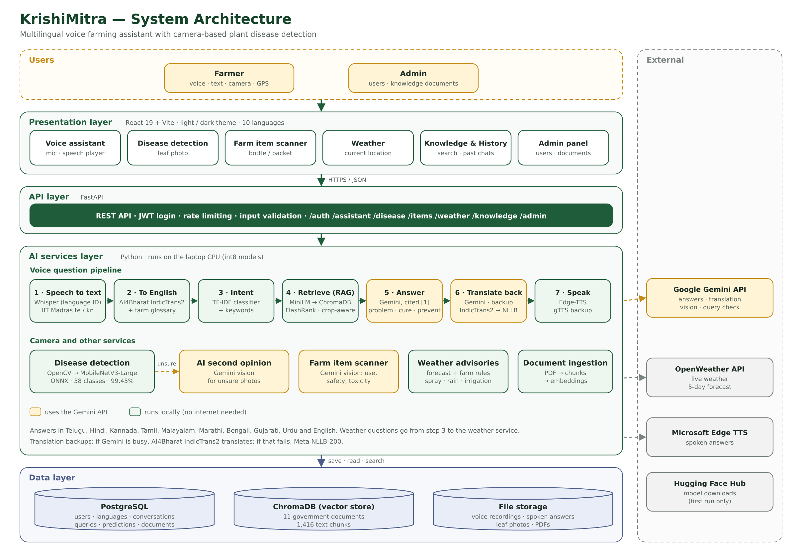

# KrishiMitra — Multilingual Voice-Based Farming Assistant with Camera-Based Plant Disease Detection

MCA Data Science major project. Farmers ask questions by voice in **10 languages** (Telugu, Hindi, Kannada,
Tamil, Malayalam, Marathi, Bengali, Gujarati, Urdu, English), get answers grounded in 11 government agricultural
documents (with sources), hear the answer spoken back, check the weather with farm advisories, photograph a leaf
to detect plant diseases, and scan a pesticide or fertilizer pack to learn how to use it safely.



```
Voice ─► Whisper (+ IIT Madras te/kn) ─► IndicTrans2 to English ─► intent ─► RAG (ChromaDB + FlashRank) ─► Gemini
      ◄─ Edge-TTS ◄─ Gemini translation (backup IndicTrans2 → NLLB) ◄───────────────────────────────────┘
Photo ─► OpenCV ─► MobileNetV3-Large (ONNX) ─► disease + treatment  (Gemini second opinion when unsure)
```

## What is in this folder

| Folder | What it is |
| --- | --- |
| `backend/` | FastAPI app: REST API, PostgreSQL models, Alembic migrations, AI services, 63 pytest tests |
| `frontend/` | React 19 + Vite app: 13 pages (farmer + admin), 17 Vitest tests |
| `ml/disease_detection/` | Research code: data split, EDA, baseline CNN vs MobileNet vs EfficientNet, evaluation, ONNX export, Colab notebook |
| `ml/intent_classification/` | Intent dataset (seed) and training/evaluation script |
| `ml/evaluation/` | Scripts for speech WER, translation chrF, retrieval hit@k/MRR, latency |
| `knowledge_base/` | Your agricultural PDFs (`documents/`) and the ChromaDB index (`chroma_db/`) |
| `trained_models/` | Trained model files the backend loads (created by the ML scripts) |
| `docs/` | Setup, structure, API, database, ML, testing and deployment guides |
| `deploy/` | Caddy (HTTPS) config and backup scripts |

## Quick start (Windows, VS Code, PowerShell)

Full step-by-step instructions with screenshots-worth of detail: **[docs/SETUP_WINDOWS.md](docs/SETUP_WINDOWS.md)**.

```powershell
# 1. Database (once): in "SQL Shell (psql)" as postgres
#    CREATE ROLE krishimitra LOGIN PASSWORD 'your_password'; CREATE DATABASE krishimitra OWNER krishimitra;

# 2. Backend
cd backend
py -3.12 -m venv .venv
.\.venv\Scripts\Activate.ps1
pip install torch --index-url https://download.pytorch.org/whl/cpu
pip install -r requirements-dev.txt
copy .env.example .env          # then edit .env (database password, JWT secret, API keys)
alembic upgrade head
python -m scripts.seed_data
python -m scripts.create_admin --name "Your Name" --phone 9876543210
uvicorn app.main:app --reload   # http://127.0.0.1:8000/docs

# 3. Frontend (second terminal)
cd frontend
npm install
npm run dev                     # http://localhost:5173
```

## Status of each module

| Module | Code | Tested here |
| --- | --- | --- |
| Auth, profiles, roles | complete | yes, against real PostgreSQL |
| Voice pipeline (STT, translation, intent, RAG, Gemini, TTS) | complete | pipeline logic, audio conversion, RAG storage and retrieval: yes. The real Whisper, NLLB, MiniLM, Gemini and Edge-TTS calls need internet and API keys, so run them on your PC (see docs/TESTING.md) |
| Disease detection API | complete | yes, with a small ONNX test model; the real model must be trained on Colab |
| Disease model training | complete scripts + notebook | data prep and EDA run; training needs a GPU (Colab) |
| Weather + advisories | complete | yes, with recorded API responses; needs your OpenWeather key for live data |
| Dashboards, history, admin | complete | yes |
| Docker deployment | complete | compose files validated; images not built here |

No accuracy numbers are claimed anywhere in this project until you run the evaluation scripts on real data.
