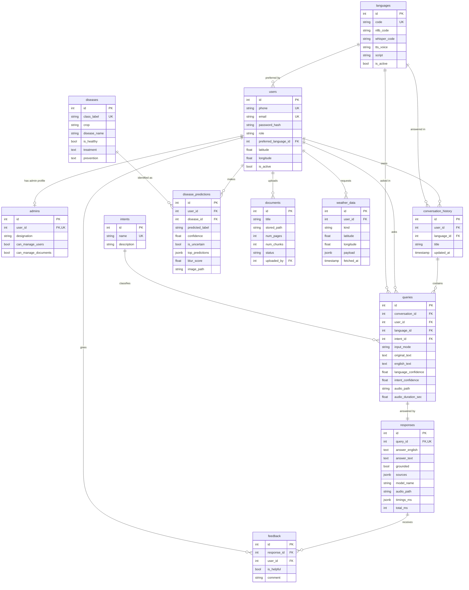

# Database design (PostgreSQL)

12 tables, created by `alembic upgrade head`. ChromaDB is separate and stores only text chunks and vectors;
each vector carries the PostgreSQL `documents.id` so both stay in sync (deleting a document deletes its vectors).

## ER diagram

Rendered image for the report: [er_diagram.png](er_diagram.png). The source is below; GitHub and VS Code (with a Mermaid extension) render it.



## Design decisions (for the report)

| Decision | Reason |
| --- | --- |
| Role column on `users` + separate `admins` table | Access is checked from one column (simple, fast); the spec's `admins` table holds admin-only details without nullable columns on every farmer row |
| `queries` and `responses` separate, 1:1 | A question exists even if answering fails; responses carry model output, sources and timings, which are analysed separately |
| `conversation_history` groups queries | Lets farmers continue a conversation and see history by topic |
| `languages` as a table, not an enum | Adding a language needs only a row, no code or migration |
| JSONB for `sources`, `timings_ms`, `top_predictions`, weather `payload` | Variable-shape data that is read whole; still queryable in PostgreSQL |
| `ON DELETE CASCADE` from users | Deleting an account removes all personal data (privacy) |
| `ON DELETE SET NULL` for intents/diseases | Reference data changes never delete history |
| CHECK constraints (role, input_mode, status, kind) | Invalid values are rejected by the database itself |
| Indexes on every foreign key and `fetched_at` | Dashboard and statistics queries stay fast as data grows |
| Unique (`response_id`, `user_id`) on feedback | One rating per answer per farmer |

## Useful commands

```powershell
alembic upgrade head                         # apply migrations
alembic downgrade -1                         # undo the last migration
alembic revision --autogenerate -m "message" # after changing a model
psql -U krishimitra -d krishimitra -c "\d queries"   # inspect a table
```
